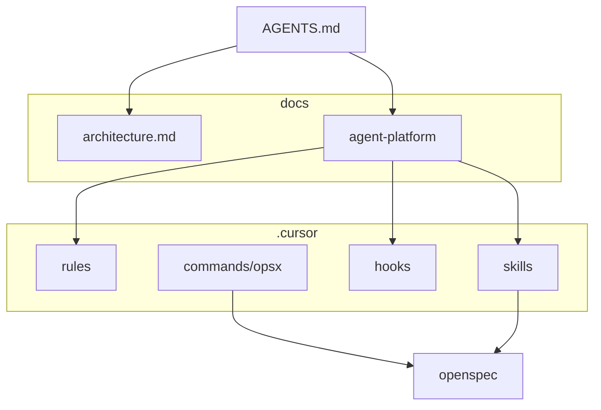

# Агентная платформа

Как в этом репозитории устроена работа Cursor: роли, спеки, skills и hooks. Это control plane рядом с микросервисами, не замена им.

Архитектура **приложения** на текущей ветке: [../architecture.md](../architecture.md).

## Зачем

Агент без границ меняет контракт, тащит следующую лабу или сносит тома. Платформа повторяет обычные инженерные ограждения.

| Практика | Где в репозитории |
|----------|-------------------|
| Design / ADR | OpenSpec `design.md` |
| Acceptance | `proposal.md`, `specs/**/spec.md`, `tasks.md` |
| Роли | [`AGENTS.md`](../../AGENTS.md), [roles.md](./roles.md) |
| Guardrails | [`.cursor/hooks.json`](../../.cursor/hooks.json) |
| Playbooks | `.cursor/skills/` |
| Стиль кода | `.cursor/rules/` |

## Состав

| Файл | Роль |
|------|------|
| [architecture.md](./architecture.md) | Как агент связан с runtime |
| [pipeline.md](./pipeline.md) | Explore → Propose → Apply → Verify → Archive |
| [roles.md](./roles.md) | Architect, Implementer, Verifier, Reviewer |

## На защите

1. [Архитектура приложения](../architecture.md) — схема ветки и sequence export.
2. [Роли](./roles.md) — кто не имеет права менять scope.
3. [Пайплайн](./pipeline.md) — артефакт на каждом шаге.
4. Skill `rvip-lab-delivery` и hook, который останавливает `docker compose down -v`.
