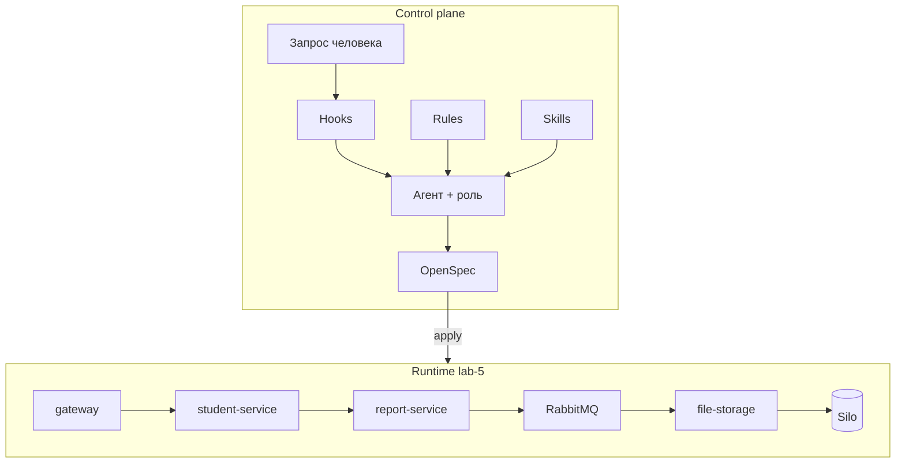
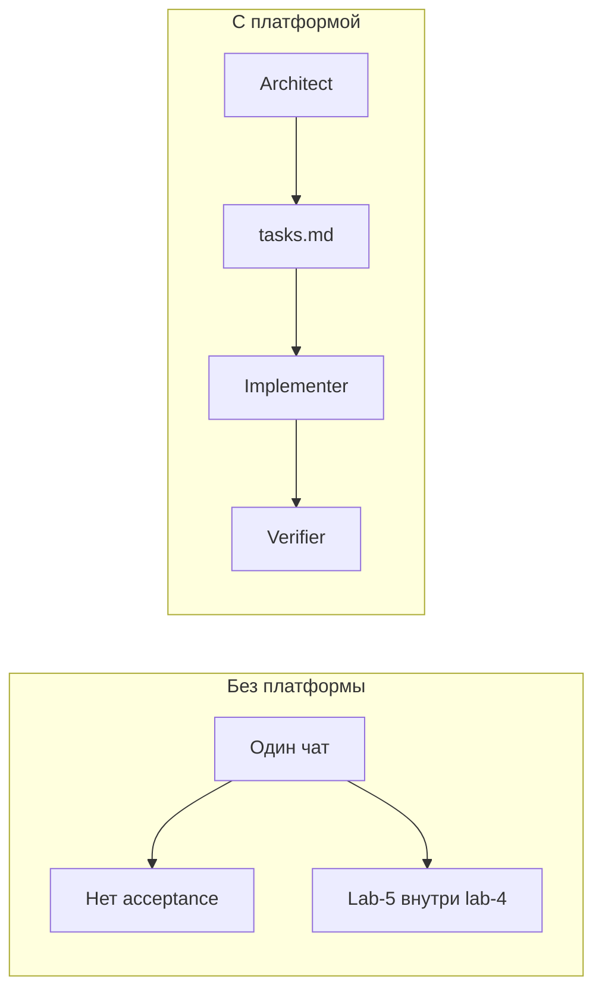

# Архитектура агентной системы

Два контура. Control plane решает, *что* менять. Runtime — сервисы текущей ветки (**lab-5**: CSV через RabbitMQ).

## Компоненты

### Rules

`.cursor/rules/*.mdc`. Постоянные ограничения: Nest-модули, `synchronize: false`, не тащить фичу следующей лабы в текущую ветку.

### Skills

`.cursor/skills/*/SKILL.md`. Пошаговые playbooks (`rvip-lab-delivery`, `rvip-verify-stack`, OpenSpec). Агент читает skill до правок, а не импровизирует процесс.

### Hooks

`.cursor/hooks.json`. События сессии и shell: контекст ветки на старте, запрет force-push в `main` и подтверждение на `compose down -v`.

### OpenSpec

`openspec/changes` и `openspec/specs`. Для lab-4 и lab-5 архивы уже лежат в `openspec/changes/archive/2026-10-10-*`. Main specs на этой ветке описывают **очередь**, не sync POST.

### Roles

Контракт поведения в [`roles.md`](./roles.md). Одна модель, разные стоп-линии.

## Почему не один агент «на всё»

## Связь с runtime lab-5

- Граница «report публикует, storage потребляет» зафиксирована в спеке `report-export-queue`.
- Sync `HttpService` до file-storage на этой ветке для export **не используется** — это контракт `lab-4`.
- Object storage — S3 API (`pgsty/silo`), не каталог на диске контейнера.
