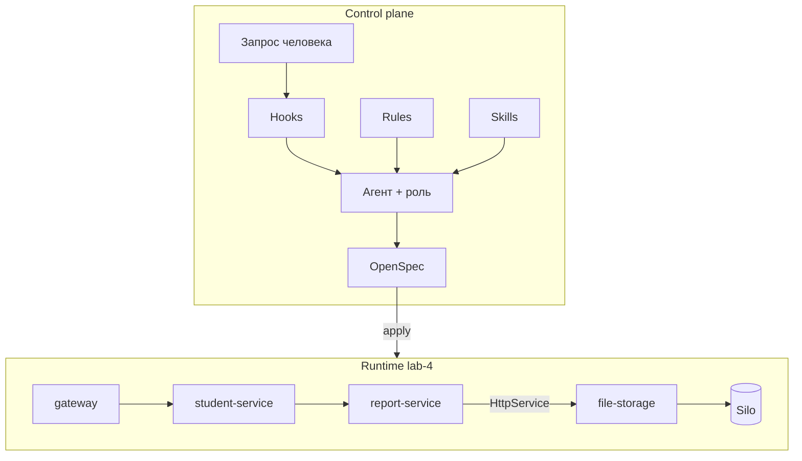
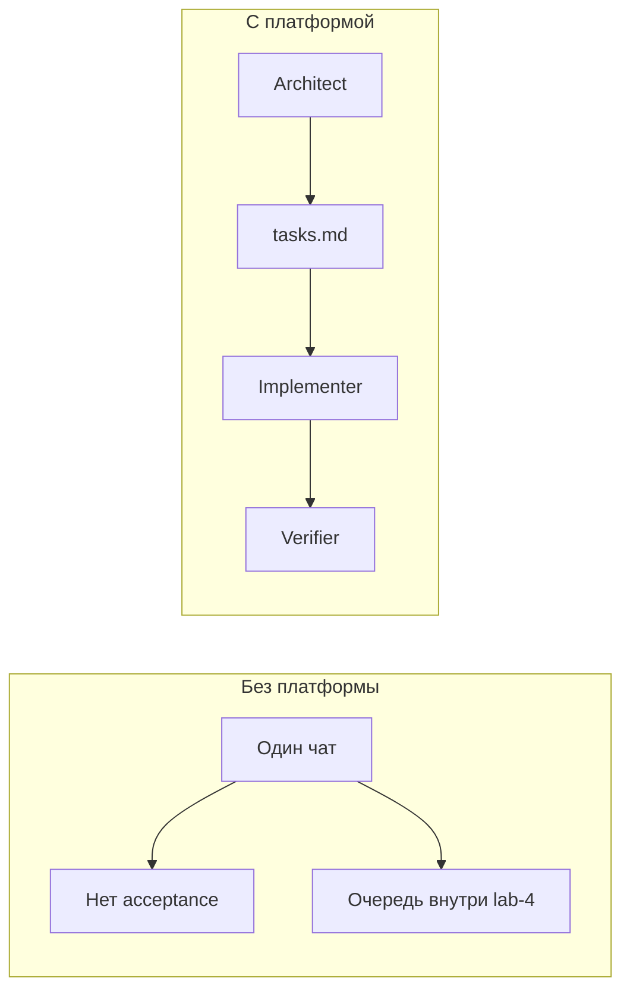

# Архитектура агентной системы

Два контура. Control plane решает, *что* менять. Runtime — сервисы текущей ветки (**lab-4**: CSV синхронно через HttpService).

## Компоненты

### Rules

`.cursor/rules/*.mdc`. Постоянные ограничения: Nest-модули, `synchronize: false`, не тащить фичу следующей лабы в текущую ветку. На `lab-4` это значит: без RabbitMQ.

### Skills

`.cursor/skills/*/SKILL.md`. Пошаговые playbooks (`rvip-lab-delivery`, `rvip-verify-stack`, OpenSpec). Агент читает skill до правок, а не импровизирует процесс.

### Hooks

`.cursor/hooks.json`. События сессии и shell: контекст ветки на старте, запрет force-push в `main` и подтверждение на `compose down -v`.

### OpenSpec

`openspec/changes` и `openspec/specs`. Архив lab-4: `openspec/changes/archive/2026-10-10-lab-4-file-storage`. Main specs описывают **синхронный** export. Спеки очереди на этой ветке нет.

### Roles

Контракт поведения в [`roles.md`](./roles.md). Одна модель, разные стоп-линии.

## Почему не один агент «на всё»

## Связь с runtime lab-4

- Report владеет CSV и сам вызывает storage. Это зафиксировано в спеке `file-storage` и delta `course-reports`.
- Вызов — `HttpService` (`POST /api/files`), Nest-эквивалент RestTemplate.
- Object storage — S3 API (`pgsty/silo`), не каталог на диске контейнера.
- Очередь `report.export.csv` появляется только на ветке `lab-5`.
