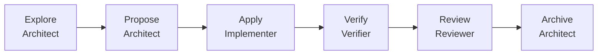

# Пайплайн сдачи лабы

Каждый шаг имеет вход, выход и критерий готовности. Роль на шаге фиксирована.



## Explore

Вход: пункт из методички и текущая ветка.  
Инструмент: `/opsx-explore`.  
Готово, когда нет вопросов, которые меняют границы сервисов.

Для lab-4 закрыли заранее: CSV собирает report, кладёт file-storage, клиент бьёт в gateway. Очередь — только lab-5.

## Propose

Инструмент: `/opsx-propose`.  
Выход: `proposal.md`, `design.md`, delta specs, `tasks.md`.  
Готово, когда Non-goals явные, а tasks — чеклист.

## Apply

Инструмент: `/opsx-apply` и skill `rvip-lab-delivery`.  
Только пункты `tasks.md`. Новый сервис копирует соседей: health, APM, Dockerfile, env в `.env.example`.

## Verify

Skill `rvip-verify-stack`.

```bash
docker compose up --build -d
curl -sf http://localhost:3080/api/reports/by-course/export
```

На **lab-5** ответ — `status: queued`, затем объект в бакете. На **lab-4** ответ — метаданные файла сразу.  
Падение фиксируется воспроизводимой командой и возвращается Implementer.

## Archive

`/opsx-archive`: change уходит в `openspec/changes/archive/`, main specs совпадают с веткой.

## Definition of Done

- Ветка запушена, `compose up --build` поднимает её стек.
- README и [архитектура](../architecture.md) описывают эту ветку, не соседнюю.
- Postman покрывает export.
- В README есть соответствие термина методички и Nest.

## Чего не делать

| Плохо | Вместо этого |
|-------|----------------|
| Сразу писать сервисы без proposal | Сначала Propose |
| Проверять «вроде работает» | curl из verify skill |
| Класть RabbitMQ в коммит lab-4 | Очередь только на `lab-5` |
