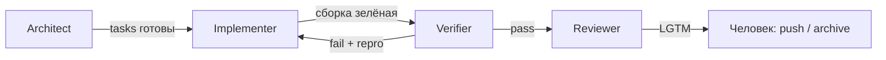

# Роли

Роль — контракт поведения, не отдельная модель. Перед задачей её называют явно.

## Architect

Фиксирует границы: кто владеет CSV, sync или очередь, какие порты снаружи, что в Non-goals.  
Пишет OpenSpec. Прод-код не пишет: если нужно поведение — это пункт в `tasks.md`.

## Implementer

Закрывает чеклист минимальным диффом по образцу соседнего сервиса.  
Не меняет acceptance. Блокер — обратно Architect, в design, а не «додумал в коде».

## Verifier

Поднимает compose и сверяет ответы со спекой. На lab-5 export обязан быть `queued`. На lab-4 — метаданные объекта.  
В этой роли код не чинит.

## Reviewer

Смотрит контракт, отказы (storage/очередь недоступны), секреты только в env, и что README не описывает чужую ветку.  
Большой рефакторинг мимо задачи не делает.

Передача между ролями — файл (tasks, отчёт verify), не договорённость в чате.
