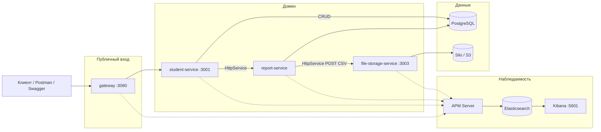
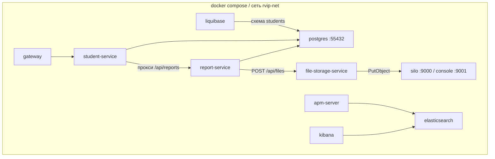
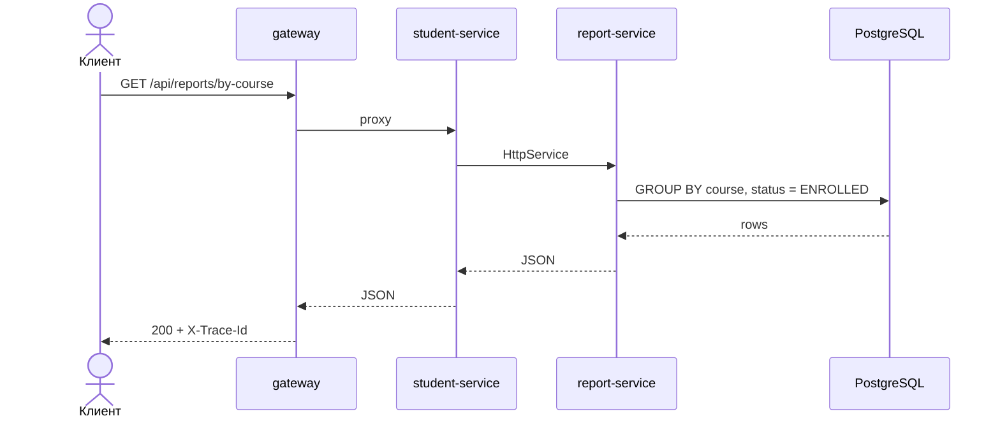
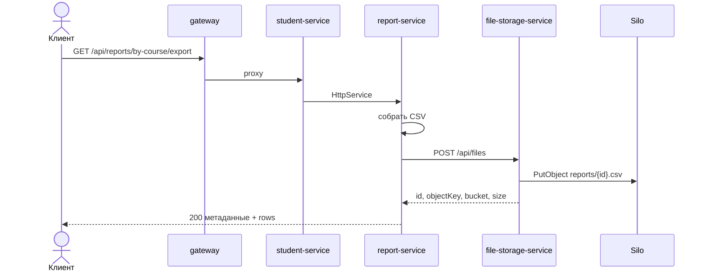

# Архитектура приложения (lab-4)

Ветка `lab-4`. И JSON-отчёт, и сохранение CSV идут **синхронно**. Очереди на этой ветке нет.

Образ object storage: `pgsty/silo` (S3-совместимый; официальный `minio/minio` снят с Docker Hub).

## Контекст

`report-service` с хоста не публикуется. Клиент ходит только в gateway.

## Контейнеры

## Два сценария отчёта

| Запрос | Поведение на lab-4 |
|--------|--------------------|
| `GET /api/reports/by-course` | Синхронный JSON `{ course, count }[]` |
| `GET /api/reports/by-course/export` | Report собирает CSV, `HttpService` делает `POST /api/files`, ответ — метаданные объекта и `rows` |

### Синхронный отчёт

### Экспорт CSV через HttpService

Это аналог RestTemplate из методички: вызов блокирующий, клиент получает файл уже сохранённым. На `lab-5` тот же URL отвечает `queued` и пишет объект из RabbitMQ.

## Кто за что отвечает

| Сервис | Владеет |
|--------|---------|
| gateway | Единый вход, `X-Trace-Id`, health upstream |
| student-service | CRUD студентов, прокси обоих report-эндпоинтов |
| report-service | Агрегат по курсам, сборка CSV, синхронный вызов storage |
| file-storage-service | `POST/GET /api/files`, запись в S3 |
| Silo | Бакет `reports` |
| PostgreSQL | Таблица `students` (схема только Liquibase) |

Имя файла и время лежат в metadata объекта, а не во второй таблице: в курсе разрешена одна таблица `students`, а идентификатор файла уже есть в ключе `reports/{id}.csv`. Нет объекта — 404. Хранилище не отвечает — 503, это не «файл не найден».

## Наружу с хоста

| URL | Назначение |
|-----|------------|
| http://localhost:3080 | Gateway |
| http://localhost:3001/api/docs | Swagger student-service |
| http://localhost:3003 | File-storage |
| http://localhost:9001 | Консоль Silo (`minioadmin` / `minioadmin`) |
| http://localhost:5601 | Kibana APM |

RabbitMQ на этой ветке не поднимается.
