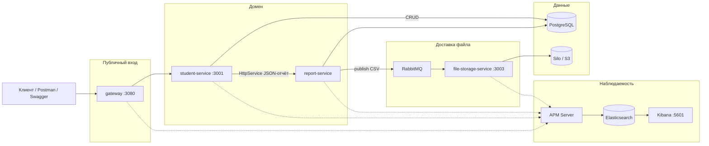
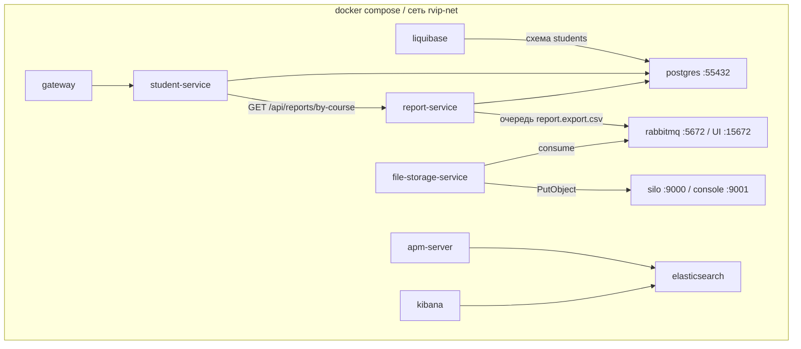
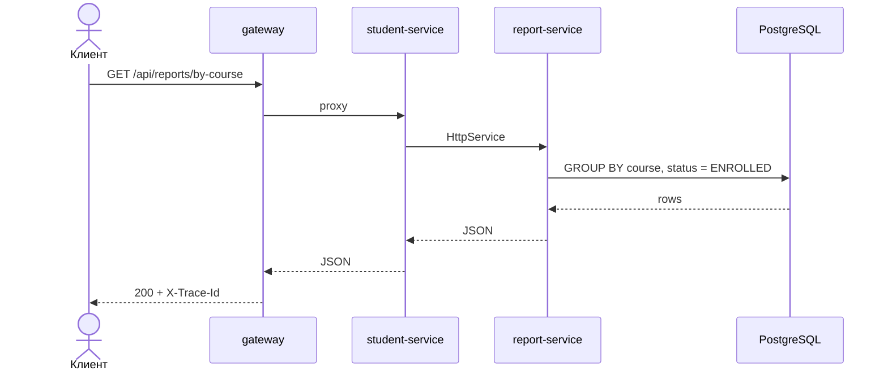
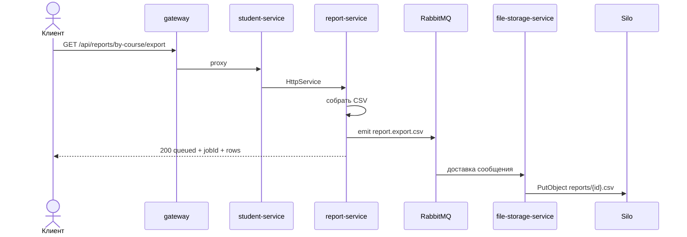

# Архитектура приложения (lab-5)

Ветка `lab-5`. Отчёт в JSON по-прежнему синхронный. CSV в файловое хранилище уходит **через очередь**.

Образ object storage: `pgsty/silo` (S3-совместимый; официальный `minio/minio` снят с Docker Hub).

## Контекст

`report-service` с хоста не публикуется. Клиент ходит только в gateway.

## Контейнеры

## Два сценария отчёта

| Запрос | Поведение на lab-5 |
|--------|--------------------|
| `GET /api/reports/by-course` | Синхронный JSON `{ course, count }[]`. Очереди нет. |
| `GET /api/reports/by-course/export` | Report публикует CSV и сразу отвечает `{ status: "queued", jobId, rows, filename }`. Файл появляется в бакете `reports` после consumer. |

### Синхронный отчёт

### Экспорт CSV через очередь

На ветке `lab-4` второго сценария нет: report вызывает `POST /api/files` синхронно и возвращает метаданные объекта сразу.

## Кто за что отвечает

| Сервис | Владеет |
|--------|---------|
| gateway | Единый вход, `X-Trace-Id`, health upstream |
| student-service | CRUD студентов, прокси обоих report-эндпоинтов |
| report-service | Агрегат по курсам, сборка CSV, публикация в очередь |
| file-storage-service | Приём сообщения, запись и чтение объекта в S3 |
| Silo | Бакет `reports` |
| RabbitMQ | Очередь `report.export.csv` |
| PostgreSQL | Таблица `students` (схема только Liquibase) |

`POST /api/files` на file-storage оставлен для ручной отладки, основной путь лабы — очередь.

## Наружу с хоста

| URL | Назначение |
|-----|------------|
| http://localhost:3080 | Gateway |
| http://localhost:3001/api/docs | Swagger student-service |
| http://localhost:3003 | File-storage |
| http://localhost:15672 | RabbitMQ UI (`guest` / `guest`) |
| http://localhost:9001 | Консоль Silo (`minioadmin` / `minioadmin`) |
| http://localhost:5601 | Kibana APM |
